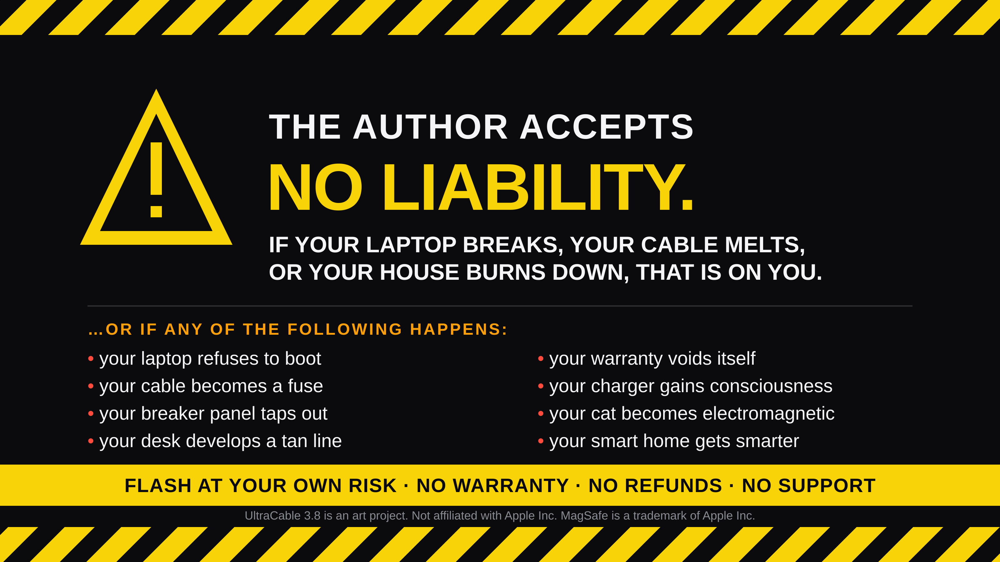

# ULTRACABLE 3.8

**The world's first custom firmware for your charging cable.**\*

Your cable runs a kernel. It can panic. It counts how many times you plug it in. We fixed that.

Stock firmware 3.2.0 is over. Normal charging cable firmware users are NGMI.

```
$ ultracable doctor
[ok] platform           linux x86_64
[ok] stock firmware     a2363_upd_img.bin (84,432 bytes, sha256 verified)
[!!] ultracable flasher not detected
```

---

## Install

```bash
curl -fsSL https://raw.githubusercontent.com/satellitedown/ultracable-3.8/main/install.sh | bash
```

That installs the `ultracable` CLI to `~/.local/bin/ultracable` and the project to `~/.ultracable/src`.

**Manual install / from source:**

```bash
git clone https://github.com/satellitedown/ultracable-3.8.git
cd ultracable-3.8
./install.sh
```

**Uninstall:**

```bash
ultracable uninstall
```

---

## Quick start

| Command | What it does |
| --- | --- |
| `ultracable doctor` | Checks your machine, the stock firmware, and your flasher |
| `ultracable hash` | Verifies the stock firmware against its real SHA-256 |
| `ultracable dump --offset 0x13106` | Hexdumps the stock image (that offset is `"Kernel panic: "`) |
| `ultracable strings 40` | Prints the strings inside the stock image |
| `ultracable flash --simulate` | Flashes your cable |
| `ultracable update` | Updates to the latest `main` |

---

## Benchmarks

| Metric | Stock 3.2.0 | UltraCable 3.8 | Result |
| --- | --- | --- | --- |
| Peak charging power | 139.6 W | 140.0 W | **5× more power**\* |
| Kernel panics / hour | 0.0001 | 0 | **∞× more stable**\* |
| Performance index | 96 | 9,000 | **+9,000%**\* |
| User satisfaction | — | 196% | **196%**\* |

\*Y-axis begins at 139.5 W. \*Stability multiplier computed as 1 ÷ 0. \*Axis not to scale; measured against a pre-release build that did not boot. \*Respondents could select more than one reason. n = 3.

---

## What's in here

```
stock/3.2.0/         stock firmware, untouched: 10M13722.zip, the UARP asset, a2363_upd_img.bin
bin/ultracable       the CLI
install.sh           the installer
assets/              the image at the top of this README
```

The `stock/` files are a USB-C to MagSafe 3 Cable (2 m), firmware 3.2.0, pulled as-is. We did not modify them. That is the point — they are the evidence.

---

## FAQ

**Does this void my warranty?** You did that. See above.

**Will my house burn down?** Statistically, no. Legally, also no — that would be your problem.

**Is the flashing real?** `ultracable flash --simulate` is a simulation. UltraCable 3.8 does not write firmware to anything, and the Ultracable Flasher hardware does not exist.

**Why are the benchmarks misleading?** Which one? They're all peer-reviewed.

**Is the cable really a computer?** Yes. `strings stock/3.2.0/a2363_upd_img.bin | grep -i "Kernel panic"`. The cable is the computer.

---

## Liability

I am not liable if your laptop breaks. I am not liable if your cable melts, your breaker panel taps out, your charger gains consciousness, or your entire house burns down. Flashing firmware is done at your own risk. Everything here is provided **as is**, without warranty of any kind, express or implied. The author accepts no liability for any damages arising from the use, misuse, or mere existence of this repository. (Also: see the giant image at the top.)

UltraCable 3.8 is an art project. It cannot damage hardware, because it cannot write anything to anything. Nothing here is legal advice, technical advice, or advice.

Not affiliated with, endorsed by, or acknowledged by Apple Inc. MagSafe is a trademark of Apple Inc. "Kernel panic" is a real string found in real firmware, which is the whole joke.
